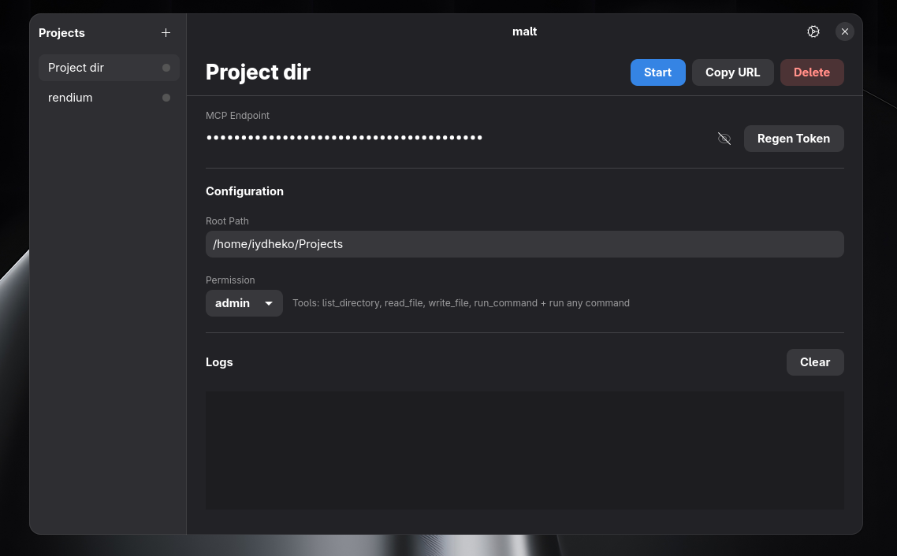

<p align="center">
  
</p>

<h1 align="center">malt</h1>

<p align="center">
  Publish and manage project folders via MCP servers
</p>

<p align="center">
  
</p>

A GTK4/libadwaita desktop app that lets you publish and manage project folders via MCP servers.

## Features

- **Multi-project management** — create, edit, and delete projects from a sidebar
- **Server controls** — start/stop MCP servers per project
- **Token auth** — each project gets a unique auth token, regenerable anytime
  (the copied endpoint uses a capability URL)
- **Admin god mode** — run any command without whitelist restrictions
- **Tunnel support** — expose local MCP servers via cloudflared tunnels
- **Status indicators** — green/grey dot in sidebar shows server state
- **Keyboard shortcut** — press `Esc` to deselect and return to empty state

## Requirements

- Python 3.12+
- GTK4 + libadwaita (system packages)
- Runtime GTK4 and libadwaita libraries (plus development headers when building
  PyGObject): `libgtk-4-1`, `libadwaita-1-0` on Debian/Ubuntu, or `gtk4`,
  `libadwaita` on Arch.
- Optional `cf`/`cloudflared` and `ngrok` binaries for tunnels. Cloudflare
  named tunnels require an authenticated local CLI and an existing tunnel.

## Installation

```bash
# Install a released wheel
python -m pip install malt

# Or install from a checkout
git clone https://github.com/ferdinankurnian/malt.git
cd malt
uv sync
```

## Usage

```bash
malt
```

1. Click **+** to add a project (name, root path, permission level)
2. Select a project from the sidebar
3. Click **Start** to launch its MCP server
4. Copy the endpoint URL and use it in your MCP client

Settings opens using local values first; Cloudflare/provider discovery
continues in the background. A tunnel exposes the selected project over the
internet, so its token is a bearer capability URL and must be treated as a
secret. The default local server binds to `127.0.0.1`; `admin`/full-terminal
permission allows arbitrary commands under the project root.

Cloudflare profiles are configured in **Settings → Domains**. Leave the field
empty to use the CLI default profile, or enter a named profile (Malt passes it
to `cf` as `--profile=<name>`). Adding a Cloudflare domain is a two-part flow:
select a zone, then enter only the subdomain prefix; Malt displays the zone
suffix and composes the final hostname.

Starting or stopping projects rebuilds the shared local MCP application and
can drop in-flight sessions. This is intentional for the single-user desktop
architecture and is not zero-downtime multi-tenant hosting.

### Permissions

| Level     | Tools |
|-----------|-------|
| `read`    | list_directory, read_file, file_info, search |
| `write`   | list_directory, read_file, file_info, search, write_file, edit_file, delete_file, move_file |
| `execute` | everything in write + run_command (whitelisted) |
| `admin`   | everything in write + run_command (any command) |

### Tool details

| Tool | Description |
|------|-------------|
| `list_directory` | List folder contents |
| `read_file` | Read file (supports `start_line` / `end_line` for partial reads) |
| `file_info` | Size, type, mtime, mode |
| `search` | Regex search across files with context |
| `write_file` | Full overwrite |
| `edit_file` | Exact string search-replace (`replace_all` optional) |
| `delete_file` | Delete a file |
| `move_file` | Move / rename within project |
| `run_command` | Run command (whitelist or free depending on level) |

## Project Structure

```
malt/
├── main.py              # App entry point, window layout
├── db.py                # SQLite schema + CRUD
├── models.py            # Project data model
├── settings.py          # App settings (tunnel hostname, default port)
├── security.py          # Allowed commands, permission levels
├── mcp_server.py        # MCP server factory
├── server.py            # HTTP server + auth middleware
├── tunnel.py            # Cloudflared tunnel manager
├── ui/
│   └── style.css        # Custom GTK CSS
└── views/
    ├── project_list.py  # Sidebar with project cards
    └── project_detail.py # Detail panel (config, server controls, logs)
```

## License

MIT

## Release checklist

- Ensure the worktree is clean and rotate any credential ever exposed.
- Confirm `.cloudflare/`, databases, and environment files are absent.
- Run `uv run ruff check malt/`, `uv run mypy malt/`, and `uv run pytest tests/`.
- Build and inspect both `uv build` artifacts before publishing.
